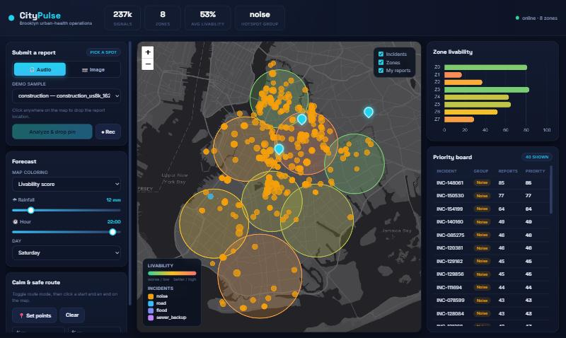
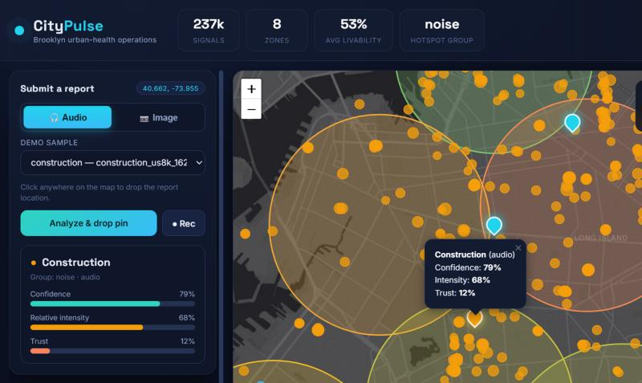
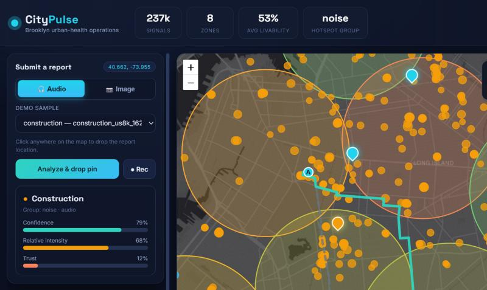

# CityPulse: Multimodal Urban Hazard Intelligence & Safer Navigation

**A data-driven urban monitoring and decision-support prototype for Brooklyn, New York.**

CityPulse combines public municipal service-request records, environmental audio and road-image classifiers, historical rainfall data, spatial clustering, complaint-trust estimation, and hazard-aware route planning in one web application. It is designed to turn large volumes of fragmented urban signals into a map-based view of recurring issues and their relative spatial concentration.

The project is an academic machine-learning and full-stack prototype. Its historical city layer is built from **NYC 311 Service Requests filtered to Brooklyn**; its image and audio classifiers are trained and evaluated on public research datasets; rainfall features come from Open-Meteo; and the routing network is obtained from OpenStreetMap. The application is therefore **not a live measurement system for Karachi or another city**, and its predictions should be interpreted as estimates derived from the datasets and assumptions described below.

> **Scope clarification:** The supplied implementation is configured around Brooklyn, New York. Earlier project planning described a city-agnostic design and a possible Karachi deployment, but the current map, complaint data, projection origin, zones, regression artifacts, and routing graph are Brooklyn-specific.

---

## Contents

- [Project at a glance](#project-at-a-glance)
- [What the application currently does](#what-the-application-currently-does)
- [System architecture](#system-architecture)
- [Application workflow](#application-workflow)
- [Machine-learning and analytical components](#machine-learning-and-analytical-components)
  - [Audio classification](#1-audio-classification)
  - [Road-image classification](#2-road-image-classification)
  - [NYC 311 data preparation](#3-nyc-311-data-preparation)
  - [Spatial hotspot zones](#4-spatial-hotspot-zones)
  - [Spatio-temporal incident deduplication](#5-spatio-temporal-incident-deduplication)
  - [Complaint trust scoring](#6-complaint-trust-scoring)
  - [Flood and noise forecasting](#7-flood-and-noise-forecasting)
  - [Hazard-aware route planning](#8-hazard-aware-route-planning)
- [Evaluation results](#evaluation-results)
- [Technology stack](#technology-stack)
- [Repository structure](#repository-structure)
- [Data sources and governance](#data-sources-and-governance)
- [Installation](#installation)
- [Running CityPulse](#running-citypulse)
- [API reference](#api-reference)
- [Reproducing the ML pipelines](#reproducing-the-ml-pipelines)
- [Tests and current verification notes](#tests-and-current-verification-notes)
- [Limitations and responsible interpretation](#limitations-and-responsible-interpretation)
- [Team](#team)
- [License and attribution](#license-and-attribution)

---

## Project at a glance

| Area | Implementation |
|---|---|
| Application | Browser-based urban hazard dashboard |
| Backend | FastAPI served by Uvicorn |
| Frontend | HTML, CSS, vanilla JavaScript |
| Map | Leaflet with an Esri World Dark Gray basemap |
| Charts | Chart.js |
| Historical municipal data | NYC 311 Service Requests, filtered to Brooklyn |
| Audio data | UrbanSound8K; ESC-50 used for cross-dataset evaluation |
| Image data | RDD2022 road-damage images, AlleyFloodNet, and a Mendeley roadway-flood image set in the recorded flood experiments |
| Weather data | Open-Meteo historical precipitation |
| Road network | OpenStreetMap, downloaded through OSMnx/Overpass when routing is first needed |
| Persistence | SQLite for the runtime incident and submitted-report data |
| Main ML methods | SVM, Random Forest, MobileNetV2 embeddings, Logistic Regression, Linear Regression, K-Means, and hierarchical agglomerative clustering |
| Runtime models | Audio classifier, image classifier, trust scorer, flood regression, and noise regression |
| Geographic scope | Brooklyn, New York; not Karachi measurements |

### Snapshot data scale

The included analytical artifacts record the following project-scale figures:

- **874,893** NYC 311 source rows in the extraction used for the cleaning report.
- **236,507** Brooklyn complaint records after borough filtering and cleaning.
- **154,599** clustered incident records produced by the spatio-temporal deduplication workflow.
- **8** spatial zones in the frozen K-Means output.

These are counts from the supplied project artifacts, not live totals. The incident count is lower than the complaint-row count because the clustering workflow groups related requests into incident clusters.

---

## What the application currently does

The supplied application and artifacts implement the following user-facing capabilities:

1. **Explore historical complaint patterns.** Display precomputed Brooklyn incident clusters and eight K-Means zones on an interactive map.
2. **Inspect issue concentration.** View zone-level counts for noise, road, flood, and sewer-backup complaint groups, along with each zone's dominant group.
3. **View a relative livability layer.** Calculate a comparative zone score from normalized complaint-group counts. This is a project-defined index, not an official quality-of-life or safety measurement.
4. **Inspect reporting density.** Switch to a data-density layer so that areas with fewer records are visibly distinguishable from areas with more reporting activity.
5. **Run a flood scenario.** Supply a rainfall amount and receive a model estimate of expected Brooklyn-wide flood complaints, apportioned across zones using their historical flood-complaint shares.
6. **Run a noise scenario.** Supply an hour and weekday and receive an estimate of expected Brooklyn-wide noise complaints, apportioned across zones using their historical noise-complaint shares.
7. **Submit a demonstration report.** Choose one of the bundled audio or image samples, select a map location, and send it to the relevant classifier. The result is stored in the local SQLite reports table and displayed as a map pin.
8. **Record a short audio sample.** The browser can record a five-second microphone sample and submit it for classification. Microphone access requires a secure browser context such as `localhost` or HTTPS.
9. **Compare routes.** Select start and end points on the map and compare a shortest-distance route with a route whose edge costs are increased near historical incident concentrations, newly submitted reports, and noise-dominated zones.
10. **View a municipal-style priority list.** Rank historical incidents using report count multiplied by a configured severity weight.

### Important distinction: implemented interface versus backend capability

The browser interface uses bundled demo media for image submissions and audio sample selection, with an optional live microphone recording path. The backend `/report` endpoint accepts an uploaded file for either `image` or `audio`, so an external client can submit an image file directly. The supplied browser UI does **not** currently provide a general-purpose photo file picker or camera-capture workflow.

The application is a local prototype. “Live” in the interface refers to interactions and reports created during the running demo; the historical municipal dataset itself is not a real-time 311 feed.

---

## System architecture

```text
┌────────────────────────────────────────────────────────────────────┐
│                         Browser frontend                           │
│                                                                    │
│  HTML + CSS + Vanilla JavaScript                                   │
│  Leaflet map · Chart.js · demo sample selector · microphone input  │
└───────────────────────────────┬────────────────────────────────────┘
                                │ HTTP / JSON / multipart form data
                                ▼
┌─────────────────────────────────────────────────────────────────────┐
│                         FastAPI backend                             │
│                                                                     │
│  /health       /demo_list       /report       /reports              │
│  /incidents    /zones           /predict      /route       /admin   │
└──────────────┬─────────────────┬───────────────────────┬────────────┘
               │                 │                       │
               ▼                 ▼                       ▼
┌─────────────────────┐  ┌──────────────────────┐  ┌──────────────────┐
│ ML inference        │  │ Analytical artifacts │  │ Routing engine   │
│                     │  │                      │  │                  │
│ Audio SVM           │  │ Brooklyn incidents   │  │ OSMnx drive graph│
│ MobileNetV2 + SVM   │  │ Eight K-Means zones  │  │ cKDTree penalties│
│ Trust Logistic Reg. │  │ Flood regression     │  │ NetworkX paths   │
│ Flood regression    │  │ Noise regression     │  │                  │
│ Noise regression    │  │                      │  │                  │
└─────────────────────┘  └──────────────────────┘  └────────┬─────────┘
                                                            │
                                                            ▼
                                                  ┌──────────────────┐
                                                  │ SQLite database  │
                                                  │                  │
                                                  │ incidents        │
                                                  │ reports          │
                                                  └──────────────────┘
```

### Backend responsibilities

`backend/main.py` creates the FastAPI application, initializes the SQLite database, loads the zone definitions, exposes the HTTP endpoints, serves the frontend and demo files, and calls the model interfaces in `src/models/`.

The ML imports are performed through helper functions when inference is requested. This delays loading large model dependencies until they are needed. The application startup still requires the incident and zone artifacts used by the backend.

### Data and artifact locations

The backend expects the following project-relative files:

```text
data/processed/text/incidents.csv
data/processed/text/zones.json
models/svm_mixed_candidate.joblib
models/intensity_bounds.joblib
models/image_model.joblib
models/trust_model.joblib
models/flood_model.joblib
models/noise_model.joblib
```

The SQLite database is created at `data/citypulse.db`. The OSMnx routing graph is cached at `data/brooklyn_drive.graphml` after the first successful route-network download. These runtime files are generated locally and are not required to be committed to Git.

---

## Application workflow

### 1. Dashboard initialization

When the browser opens the application, the frontend:

- initializes the Leaflet map centered on Brooklyn;
- loads the zone definitions from `GET /zones`;
- loads a limited set of historical incidents from `GET /incidents`;
- restores locally persisted demo submissions from `GET /reports`;
- loads the bundled sample inventory from `GET /demo_list`;
- requests the initial flood/noise scenario values from `POST /predict`.

### 2. Historical map layers

The map separates the information into independently toggleable layers:

- **Zones:** circles centered on K-Means cluster centers, with a radius based on the stored 90th-percentile cluster radius.
- **Incidents:** markers representing deduplicated historical incidents. The API returns the highest-count incidents first and limits the response size.
- **Reports:** pins for submissions made through the running application and stored in SQLite.

The zone popup includes its ID, dominant group, total record count, and counts by complaint group.

### 3. Report submission

For a bundled sample, the user selects the modality and sample, clicks the map to choose a location, and submits it. For live audio, the browser records approximately five seconds and posts the resulting WebM payload.

The backend:

1. validates that the modality is `audio` or `image`;
2. writes the upload to a temporary directory;
3. converts non-WAV audio to mono, 22,050 Hz WAV using FFmpeg;
4. calls `predict_audio()` or `predict_image()`;
5. maps the predicted class to a broader complaint group;
6. attempts to obtain a trust score using the supplied location and current time;
7. writes the result to the SQLite `reports` table; and
8. returns the result payload to the browser.

The trust score is best-effort: if feature construction or trust inference fails for a submission, the API can return `null` for `trust` while still returning the classifier result.

### 4. Forecasting

The frontend sends rainfall, hour, and weekday inputs to `/predict`. The backend can return flood results, noise results, or both. It produces a citywide expected count from the relevant regression model and distributes that total among zones in proportion to the corresponding historical group counts.

This zone allocation is a proportional visualization step. The flood and noise regressions are not independently trained spatial models for each zone.

### 5. Route planning

The user switches the map into route mode, clicks once for the origin and again for the destination, then requests a route. The backend computes:

- a baseline path using OSMnx/NetworkX edge length; and
- a hazard-weighted path using the custom `safe` edge weight.

The frontend draws both paths and reports their lengths and the difference. The safe path is a heuristic route that avoids areas assigned higher penalties; it is not a guarantee that a road is safe, quiet, accessible, or currently passable.

---

## Machine-learning and analytical components

### 1. Audio classification

**Implementation:** `src/preprocessing/audio.py`, `src/preprocessing/degrade.py`, `src/preprocessing/intensity.py`, `src/models/audio.py`.

**Primary dataset:** UrbanSound8K. ESC-50 is used for a separate cross-dataset evaluation on overlapping sound categories; it is not treated as interchangeable with the UrbanSound8K training split.

#### Target classes

The application exposes five acoustic classes:

| Application label | Dataset categories used |
|---|---|
| `traffic_horn` | UrbanSound8K car horn and engine idling; selected matching ESC-50 categories for external evaluation |
| `construction` | UrbanSound8K drilling and jackhammer; selected ESC-50 chainsaw and hand-saw examples for external evaluation |
| `siren` | Siren recordings |
| `music_loudspeaker` | UrbanSound8K street music |
| `hvac` | UrbanSound8K air conditioner |

The cross-dataset evaluation only covers classes for which a meaningful label mapping exists. The five application classes should not be interpreted as five equally represented categories in ESC-50.

#### Audio preprocessing and features

- Audio is loaded as mono and resampled to **22,050 Hz**.
- Each model input is fixed to **4 seconds** (88,200 samples), padding shorter clips and truncating longer clips.
- Librosa computes a **64-band Mel spectrogram**.
- The power spectrogram is converted to a log/dB representation using the clip maximum as the reference.
- The model feature vector concatenates the per-band temporal mean and standard deviation, producing **128 features**.
- A separate RMS-based signal level is computed from the unpadded waveform and normalized using training-derived fifth- and ninety-fifth-percentile bounds. The resulting value is a **relative intensity score from 0 to 1**, not a calibrated environmental sound-pressure measurement.

The browser records five seconds, while the inference preprocessing uses the first four seconds after resampling. This is intentional in the current implementation.

#### Degradation experiment

The audio preprocessing package includes a simulated recording-degradation function that applies:

1. a fourth-order low-pass Butterworth filter around 4 kHz;
2. additive white noise at a randomly selected signal-to-noise ratio between 10 and 20 dB; and
3. mild amplitude clipping.

The mixed candidate model is trained using clean and degraded training examples. This experiment evaluates robustness to the chosen simulated transformations; it does not establish performance on real low-cost phone microphones.

#### Runtime model

`predict_audio(path)` loads `models/svm_mixed_candidate.joblib` and `models/intensity_bounds.joblib`. It returns:

```python
{
    "type": "construction",
    "confidence": 0.75,
    "relative_intensity": 0.62
}
```

The values above illustrate the response shape only; they are not a promised prediction for a particular recording. The confidence is the classifier's maximum predicted class probability, not a guarantee of correctness.

### 2. Road-image classification

**Implementation:** `src/image/`, `src/models/image.py`.

The image pipeline combines road-damage imagery with flood/non-flood imagery to support four application labels:

- `pothole`
- `crack`
- `flood`
- `normal`

#### Feature extraction

- Images are converted to RGB.
- They are resized to **224 × 224** pixels.
- ImageNet mean and standard-deviation normalization is applied.
- A pretrained **MobileNetV2** backbone is used as a fixed feature extractor.
- The classifier head is replaced with an identity layer, leaving a **1,280-dimensional** pooled feature representation.
- Classical estimators are trained on the extracted embeddings.

The packaged `models/image_model.joblib` contains both the estimator and the MobileNetV2 backbone state required by the runtime interface. The inference code reconstructs the backbone with `weights=None` and loads the bundled state, so it does not need to download pretrained weights at prediction time.

#### Training and validation approach

The image training code compares an SVM pipeline with a Random Forest. Grouped cross-validation is used by image ID so patches or related crops from the same source image are not split across folds. The validation split is used for model selection, and the held-out test split is used for final reporting.

The image-level class labels are derived from dataset annotations and source labels. In particular, an image without a damage annotation is treated as normal under the dataset-building rules; this is a practical label construction rule, not proof that every such image is completely free of visible road defects.

#### Runtime model

`predict_image(path)` returns the predicted class and the maximum class probability:

```python
{
    "type": "pothole",
    "confidence": 0.72
}
```

The probability is a relative model score. The interface also provides `predict_image_proba(path)` for the full class-probability mapping.

### 3. NYC 311 data preparation

**Implementation:** `src/preprocessing/`, supporting notebooks in `notebooks/`.

CityPulse uses NYC 311 Service Requests, dataset identifier `erm2-nwe9`, as the historical municipal complaint source. The current analytical artifacts are filtered to **Brooklyn**.

#### Cleaning summary

The saved cleaning report documents this sequence:

1. Start from 874,893 extracted NYC 311 rows.
2. Keep rows whose borough is `BROOKLYN` (236,507 rows remain).
3. Remove duplicate `unique_key` values (none were removed in the recorded cleaning summary).
4. Remove rows with missing or zero latitude/longitude (none were removed in the recorded summary).
5. Apply the Brooklyn coordinate bounding box (no rows were removed in the recorded summary).
6. If a closing timestamp precedes the creation timestamp, set the closing timestamp to missing rather than deleting the complaint.
7. Normalize the incident address for downstream weak-label and duplicate-analysis workflows.

The feature engineering stage adds temporal attributes such as hour, weekday, month, date, and time-to-close, as well as local projected coordinates in metres. The projection uses a fixed Brooklyn origin stored in `data/processed/text/projection.json`:

```json
{
  "lat0": 40.661641,
  "lon0": -73.952455
}
```

The local equirectangular projection is an approximation suitable for this bounded study area; it is not a general-purpose global coordinate reference system.

#### Complaint groups

The downstream analytical pipeline uses four broad groups:

- `noise`
- `road`
- `flood`
- `sewer_backup`

These groups are constructed from NYC 311 complaint types and descriptors. They are analysis categories defined by the project, not official NYC 311 taxonomic labels. Complaint-type taxonomies and resolution wording can change over time, so the project includes discovery and audit notebooks and CSV outputs.

### 4. Spatial hotspot zones

**Implementation:** `src/clustering/kmeans_zones.py`.

The zone workflow clusters projected complaint locations using scikit-learn K-Means. The saved zone metadata identifies the selected configuration as:

| Parameter | Saved value |
|---|---:|
| Zone count (`K`) | 8 |
| Random seed | 42 |
| `n_init` | 10 |
| Variant | `capped_balanced` |
| Rows represented in zone metadata | 236,507 |

The pipeline includes weighted-location handling and evaluation helpers for candidate K values, silhouette analysis, stability, and alternative weighting variants. The checked-in `zones.json` contains each zone's center, total count, dominant group, group counts, group lift values, and a 90th-percentile radius used for map rendering.

#### Livability index shown in the browser

The current frontend calculates its displayed livability score from the normalized counts of four groups (`noise`, `road`, `flood`, and `sewer_backup`). Each group is min-max normalized across the eight zones, the four normalized values are averaged, and the result is inverted so that a higher value means fewer complaints relative to the other zones in this dataset.

This is a **relative, prototype-specific index**. It is not a learned target, official livability indicator, per-capita rate, or causal assessment of neighborhood conditions. It can be affected by population, reporting behavior, and the selected study window.

### 5. Spatio-temporal incident deduplication

**Implementation:** `src/clustering/hierarchical_dedup.py`.

The purpose of this stage is to reduce repeated nearby service requests into clusters that can be interpreted as incidents. The implementation uses hierarchical agglomerative clustering with a spatio-temporal distance representation and computational blocking.

Key design details recorded in `data/processed/text/incidents_meta.json` include:

- **Input rows:** 236,507 cleaned Brooklyn complaints.
- **Output clusters:** 154,599 incident records.
- **Spatial blocking:** 500-metre grid cells, separated by complaint group and calendar day in the block construction.
- **Time scale:** 50 metres per hour in the combined distance representation.
- **Selected distance threshold:** 200.
- **Output:** incident ID, representative coordinates, complaint count, group, first/last timestamps, and zone assignment.

The implementation contains chunking and precomputed-linkage helpers to make hierarchical clustering tractable on larger data. The metadata also records an equivalence check on 30 random chunks against scikit-learn's agglomerative clustering implementation for selected thresholds.

These are algorithmic clusters, not independently verified ground-truth incidents. Blocking can split related reports that fall on different block boundaries or calendar days, while broad thresholds can merge distinct nearby events. The output should therefore be interpreted as deduplicated complaint clusters rather than confirmed physical events.

### 6. Complaint trust scoring

**Implementation:** `src/models/trust.py`, `src/models/trust_label_rules.csv`, and `models/trust_model.joblib`.

The trust model estimates whether a historical 311 complaint resembles complaints that received a resolution classified as valid under the project's rule set. It is not a fraud detector and does not verify a newly submitted report against independent evidence.

#### Proxy target construction

Resolution descriptions are mapped to `valid`, `invalid`, or `excluded` using explicit text rules stored in `src/models/trust_label_rules.csv`. Rows without sufficient resolution evidence are excluded from the binary training target. The label therefore reflects a proxy derived from administrative resolution text and agency processes, not an objective ground-truth determination of whether the reported condition existed.

#### Features

The feature builder uses one-hot encoded categorical values for:

- complaint type;
- descriptor group;
- submission channel;
- location type;
- hour of day; and
- weekday.

It also uses `nearby_prior_24h_200m`: the count of earlier complaints within 200 metres during the strictly backward-looking 24-hour interval. Records with the same timestamp and the current record itself are excluded from this count.

A class-weighted Logistic Regression model is trained and the model bundle includes its encoder, feature schema, training cutoff, label-rule hash, calibration metadata, and prior-shift information.

#### Runtime interpretation

The backend creates a minimal feature record for each new submission using its predicted complaint group, current local server time, selected location, and a default nearby-prior count of zero. It then attempts to score that record. Because the runtime feature record is not a full historical 311 record and the nearby count is currently supplied as zero, the displayed score is a best-effort model estimate under those inputs.

A trust score should not be read as a verified probability that a citizen is telling the truth. It is a model output trained against a noisy administrative proxy.

### 7. Flood and noise forecasting

**Implementation:** `src/models/regression.py` and the serialized regression models in `models/`.

Both regressions model historical Brooklyn complaint counts. They are not physical flood simulations, acoustic measurements, or causal models of environmental conditions.

#### Flood regression

The flood pipeline aligns daily precipitation with daily flood-complaint counts. Its engineered historical features include:

- same-day rainfall (`rain_t`);
- rainfall one day earlier (`rain_t1`);
- rainfall two days earlier (`rain_t2`); and
- the sum of rainfall over the three preceding days (`rain_sum_t1_t3`).

Temporal/rolling-origin evaluation helpers are included to avoid random shuffling across time. At runtime, however, `predict_flood_risk(rain_mm)` accepts only one rainfall amount and explicitly assumes **dry antecedent conditions** by setting the lag features to zero. It returns an expected non-negative Brooklyn-wide complaint count for that scenario.

The UI's zone-level flood values are allocated from that citywide estimate according to each zone's historical share of flood complaints. They are not independent zone-specific forecasts.

#### Noise regression

The noise pipeline models hourly Brooklyn noise-complaint counts using hour-of-day and weekday features. The repository contains both an additive model (`models/noise_model.joblib`) and an interaction-model artifact (`models/noise_model_v2.joblib`). The backend currently calls `predict_noise()` without specifying a version, so the runtime endpoint uses the **v1 additive model** by default. The v2 interaction model is available in the repository but is not the default model used by the current `/predict` endpoint.

As with flood results, the citywide expected noise count is allocated across zones in proportion to historical zone noise counts. The result is a scenario estimate based on historical complaint patterns, not a measured sound-level forecast.

### 8. Hazard-aware route planning

**Implementation:** `backend/routing.py` and `POST /route` in `backend/main.py`.

The route planner obtains a drivable street graph from OpenStreetMap through OSMnx. It tries a list of Overpass API endpoints, caches a successful graph in `data/brooklyn_drive.graphml`, and reuses the graph on subsequent calls. The default graph radius is 3,500 metres around the mean zone center and can be changed with the `CITYPULSE_ROUTE_DIST` environment variable.

For each graph edge, the planner computes a midpoint and assigns a custom cost:

\[
  w(e) = \operatorname{length}(e) \times (1 + \operatorname{penalty}(e))
\]

The penalty has three components:

1. **Historical incident density:** a SciPy `cKDTree` counts historical incident coordinates within 100 metres of each edge midpoint. The density penalty is `min(6, 1.2 × log(1 + count))`.
2. **Newly submitted reports:** report locations stored in SQLite are treated as additional hazards. Edges within 130 metres receive a penalty of 40; edges between 130 and 260 metres receive a penalty of 8.
3. **Noise-dominated zones:** edges inside a noise-dominated zone receive an additional penalty of 2.

The backend then computes one shortest path using the ordinary edge length and another using the hazard-weighted edge cost. The response includes both coordinate paths, their lengths, the detour difference, and the number of historical plus newly submitted hazard points considered.

**Interpretation:** This is a weighted shortest-path heuristic over a downloaded road graph. It does not use live traffic, road closures, turn restrictions beyond what the graph provides, accessibility data, real-time noise sensors, or verified hazard severity. A lower weighted cost does not guarantee a safer or quieter journey.

---

## Evaluation results

The following values are transcribed from the CSV evaluation artifacts included in the supplied project snapshot. They are dataset-specific experimental results, not production guarantees.

### Audio classifier

The audio comparison report (`reports/audio/svm_vs_rf.csv`) records the following held-out Fold 10 results for the clean-data comparison:

| Model | Fold 10 accuracy | Macro F1 | Grouped CV mean |
|---|---:|---:|---:|
| SVM | 79.67% | 0.7780 | 0.6774 |
| Random Forest | 75.21% | 0.7178 | 0.6864 |

The deployed audio artifact is the mixed SVM candidate trained with clean and degraded examples. In `reports/audio/degraded_training_eval.csv`, its clean Fold 10 accuracy is **78.18%** (macro F1 **0.7656**). Across the three recorded degraded test variants, its accuracy is approximately **75.21%–75.37%**, showing that training with the chosen degradation transformations substantially reduces the drop seen when a clean-only model is evaluated on degraded clips.

The separate cross-dataset report (`reports/audio/cross_dataset_eval.csv`) records **63.5% accuracy** for the mixed SVM on its three-class ESC-50 matching subset. This lower score illustrates the domain and dataset shift between UrbanSound8K and ESC-50. It must not be compared directly with the five-class Fold 10 result without accounting for the different class subset and evaluation set.

### Image classifier

The image evaluation summary (`reports/image/metrics_summary.csv`) reports:

| Model | Test samples | Test accuracy | Balanced accuracy | Macro F1 |
|---|---:|---:|---:|---:|
| SVM | 871 | 71.87% | 72.23% | 0.7255 |
| Random Forest | 871 | 64.41% | 67.19% | 0.6552 |

The SVM was selected for the packaged image inference model. Its test-set class F1 scores in `reports/image/per_class_metrics.csv` are:

| Class | Precision | Recall | F1 | Support |
|---|---:|---:|---:|---:|
| Crack | 0.6835 | 0.6478 | 0.6652 | 230 |
| Flood | 0.9185 | 0.9323 | 0.9254 | 133 |
| Normal | 0.7071 | 0.7571 | 0.7312 | 354 |
| Pothole | 0.6115 | 0.5519 | 0.5802 | 154 |

The pothole class is notably weaker than the flood class in this test split. The aggregate accuracy should therefore not be used as a substitute for class-specific evaluation.

### Flood-image experiments

The flood experiment report (`reports/image/flood_crossset_results.csv`) contains several distinct tests:

- AlleyFloodNet official train/test split: 92.37% accuracy on 262 test images.
- AlleyFloodNet-trained model tested on RDD2022 road images: 60.38% accuracy, equivalent to a 39.62% false-alarm rate when every RDD2022 image is treated as non-flood.
- AlleyFloodNet-trained model tested on RDD2022 normal images: 58.07% accuracy, equivalent to a 41.93% false-alarm rate.
- The recorded Mendeley roadway-flood test is positive-only; its reported accuracy is therefore a flood recall-like result and does not provide a two-class estimate by itself.
- A combined Mendeley flood plus RDD2022 non-flood experiment is also recorded, with 78.29% accuracy on 1,050 images.

These experiments have different source compositions and label distributions. They should be presented separately, with the positive-only limitation made explicit, rather than summarized as one universal flood-classification accuracy.

### Brooklyn data and clustering

The included metadata records 236,507 cleaned complaint rows, 154,599 deduplicated incident clusters, and eight zones. The clustering output is evaluated with internal/weak-label diagnostics; there is no independent authoritative incident-level ground truth in the supplied project artifacts.

### Trust and regression evaluation

The repository contains trust-model evaluation helpers, calibration/reliability outputs, ablation and sensitivity analysis, flood/noise regression plots, and temporal evaluation notebooks under `reports/text/` and `notebooks/`. Interpret these results using the associated experiment definitions and time splits. The runtime forecasts have narrower input assumptions than the full historical feature sets, as described above.

---

## Technology stack

| Layer | Technologies |
|---|---|
| API server | Python, FastAPI, Uvicorn, Pydantic, `python-multipart` |
| Data processing | Pandas, NumPy |
| Classical ML | scikit-learn, Joblib |
| Deep learning / image backbone | PyTorch, Torchvision, MobileNetV2 |
| Audio processing | Librosa, SoundFile, SciPy, FFmpeg |
| Geospatial analysis | OSMnx, NetworkX, SciPy `cKDTree` |
| Database | SQLite |
| Frontend | HTML5, CSS3, vanilla JavaScript |
| Mapping | Leaflet |
| Charts | Chart.js |
| Experiments | Jupyter, IPython |
| Visualization during analysis | Matplotlib, Seaborn |

---

## Repository structure

The following is a functional overview of the repository. It groups related experiment files rather than listing every notebook and generated report.

```text
CityPulse/
├── backend/
│   ├── main.py                 # FastAPI app, endpoints, SQLite setup, static file serving
│   └── routing.py              # OSMnx graph acquisition and hazard-weighted routing
│
├── frontend/
│   ├── index.html              # Dashboard markup
│   ├── app.js                  # Map, layers, reports, forecasts, route controls, API calls
│   └── style.css               # Responsive dashboard styling
│
├── src/
│   ├── clustering/
│   │   ├── kmeans_zones.py     # Weighted spatial clustering and zone evaluation
│   │   └── hierarchical_dedup.py # Spatio-temporal blocking and hierarchical clustering
│   ├── image/
│   │   ├── run_all.py          # Image pipeline orchestration
│   │   ├── s1_s2_inspect_rdd.py
│   │   ├── s3_build_rdd_dataset.py
│   │   ├── s4_prepare_flood.py
│   │   ├── s5_extract_embeddings.py
│   │   ├── s6_train_models.py
│   │   ├── s7_flood_crossset.py
│   │   ├── s8_package_demo.py
│   │   ├── s9_augmentation_experiment.py
│   │   └── README.md            # Image-pipeline-specific instructions
│   ├── models/
│   │   ├── audio.py             # Audio prediction interface
│   │   ├── image.py             # Image prediction interface
│   │   ├── regression.py        # Flood/noise model training and inference helpers
│   │   ├── trust.py             # Proxy-label, feature, training and scoring logic
│   │   ├── baselines.py         # Optional metadata classification baselines
│   │   └── trust_label_rules.csv
│   ├── preprocessing/
│   │   ├── audio.py             # Fixed-duration audio and 128-d feature extraction
│   │   ├── complaints.py        # NYC 311 cleaning
│   │   ├── degrade.py           # Simulated audio degradation
│   │   ├── features.py          # Temporal and spatial feature engineering
│   │   ├── intensity.py         # RMS-based relative intensity
│   │   └── ...                  # 311 exploration, grouping and data-preparation modules
│   ├── inventory.py             # Dataset inventory utilities
│   └── nbutils.py                # Notebook utilities
│
├── models/                       # Serialized inference/training model artifacts
│   ├── svm_mixed_candidate.joblib
│   ├── intensity_bounds.joblib
│   ├── image_model.joblib
│   ├── trust_model.joblib
│   ├── flood_model.joblib
│   ├── noise_model.joblib
│   └── noise_model_v2.joblib
│
├── data/
│   ├── raw/                      # Raw upstream datasets (not committed)
│   └── processed/
│       ├── audio/                # Extracted audio features and labels
│       ├── image/                # Image embeddings, labels and manifests
│       └── text/                 # Brooklyn 311 tables, incidents, zones, rainfall, metadata
│
├── demo_samples/
│   ├── audio/                    # Bundled WAV demonstration clips and manifest
│   └── images/                   # Bundled JPG demonstration images
│
├── notebooks/                    # EDA, experiments, evaluation and model-development records
├── reports/
│   ├── audio/                    # Audio metrics, confusion matrices and robustness results
│   ├── image/                    # Image metrics, confusion matrices and flood experiments
│   └── text/                     # 311, clustering, trust and regression diagnostics
│
├── docs/
│   ├── screenshots/              # Dashboard, report-result and route screenshots
│   ├── reproduce.md              # Reproduction notes
│   ├── demo_script.md            # Demonstration walkthrough
│   ├── audio_rules.md            # Audio split and preprocessing constraints
│   ├── video_rules.md            # Image-pipeline constraints
│   ├── CityPulse_Proposal.pdf
│   └── CityPulse_Execution_Guide.pdf
│
├── tests/                        # Unit and artifact/data validation tests
├── environment.yml               # Conda environment (Python 3.11 + FFmpeg)
├── requirements.txt              # Python dependencies
├── requirements-lock.txt         # Dependency lock/snapshot
├── run.ps1                       # Windows launcher
├── run.sh                        # macOS/Linux launcher
├── LICENSE
└── README.md
```

Some generated or raw inputs are intentionally excluded from version control. In particular, `data/raw/`, runtime SQLite databases, and cached GraphML files are not source-controlled. A few preprocessed artifacts and model binaries are present in the supplied development snapshot; do not assume that every intermediate file required to rerun every notebook is included in a fresh clone.

---

## Data sources and governance

CityPulse uses publicly available datasets and services. The project does not claim to have collected a representative sample of Brooklyn residents' reports, road imagery, or environmental audio itself.

| Source | Role in CityPulse | Important qualification |
|---|---|---|
| [NYC 311 Service Requests](https://data.cityofnewyork.us/Social-Services/311-Service-Requests-from-2020-to-Present/erm2-nwe9) | Historical complaint records, locations, timestamps, descriptors, and resolution text | The project filters the records to Brooklyn and derives its own complaint groups and proxy labels. |
| [UrbanSound8K](https://urbansounddataset.weebly.com/urbansound8k.html) | Main labeled urban-audio dataset | Research dataset categories are mapped into the project's five application classes. |
| [ESC-50](https://github.com/karolpiczak/ESC-50) | External audio evaluation on overlapping categories | Cross-dataset labels are a subset mapping; performance is not directly comparable to the five-class in-dataset test. |
| [RDD2022](https://github.com/sekilab/RoadDamageDetector) | Road-damage images and non-flood road examples | The supplied image pipeline uses a selected subset and derives classification labels from damage annotations. |
| AlleyFloodNet | Flood/non-flood image training and evaluation | Dataset availability, version, and reuse terms should be checked against the source distribution used by the team. |
| Mendeley roadway-flood image set | Additional roadway-flood evaluation | The recorded positive-only evaluation cannot estimate a complete two-class classification score by itself. |
| [Open-Meteo](https://open-meteo.com/) | Historical precipitation features for flood regression | Rainfall observations are aligned to the Brooklyn complaint time series; they are not street-level flood measurements. |
| [OpenStreetMap](https://www.openstreetmap.org/) | Drivable road graph for route planning | Map data is subject to ODbL attribution and terms. The graph is downloaded at runtime through OSMnx. |

### Data handling principles

- Raw upstream datasets are not intended to be committed to the repository.
- The `.gitignore` excludes raw data, runtime databases, and cached routing graphs.
- The repository includes selected derived tables, model artifacts, demo samples, and experiment outputs to support the prototype and review.
- NYC 311 complaint groups are project-defined mappings, not official ground-truth hazard labels.
- Trust-scoring labels are proxies derived from resolution text and must be disclosed as such.
- Relative audio intensity is not a calibrated dB or dB(A) measurement and must not be used to establish legal noise violations.
- Public research datasets do not establish model performance on Karachi roads, real citizen phone recordings, or other cities.
- Dataset licensing is separate from the repository's software license. Check each upstream dataset's current license and attribution requirements before redistribution or commercial use.

---

## Installation

### Prerequisites

- Git
- Miniconda or Anaconda
- Python 3.11 (provided by `environment.yml`)
- FFmpeg (installed through the Conda environment definition)
- Internet access for package installation and the first OSMnx road-network download

### 1. Clone the repository

```bash
git clone https://github.com/abdulhayykhan/CityPulse.git
cd CityPulse
```

The development snapshot reviewed for this README was supplied as the `dev` branch. If you want to reproduce that exact working snapshot and the branch is available in your clone:

```bash
git switch dev
```

If you intentionally want the default branch instead, remain on the branch checked out by `git clone` and verify that its files match the documentation before running the project.

### 2. Create the Conda environment

```bash
conda env create -f environment.yml
conda activate citypulse
```

The environment file specifies Python 3.11 and installs FFmpeg plus the Python dependencies from `requirements.txt`.

Verify the main imports:

```bash
python -c "import numpy, pandas, sklearn, librosa, torch, fastapi, osmnx; print('CityPulse dependencies loaded')"
```

### 3. Check required artifacts

Before starting the API, verify that the following files exist in the repository checkout:

```text
data/processed/text/incidents.csv
data/processed/text/zones.json
models/svm_mixed_candidate.joblib
models/intensity_bounds.joblib
models/image_model.joblib
models/trust_model.joblib
models/flood_model.joblib
models/noise_model.joblib
```

The backend initializes its SQLite `incidents` table from `data/processed/text/incidents.csv` if that table does not already exist, and loads zone metadata from `data/processed/text/zones.json` during application startup. If either required data file is absent, startup will fail with a file-not-found error.

Model files are loaded when their corresponding inference path is first used. If a model artifact is missing or incompatible with the installed library versions, the relevant endpoint will fail when that model is invoked.

---

## Running CityPulse

Run commands from the repository root.

### Option A: Windows PowerShell

```powershell
conda activate citypulse
.\run.ps1
```

To use another port:

```powershell
.\run.ps1 -Port 8001
```

### Option B: macOS / Linux

```bash
conda activate citypulse
chmod +x run.sh
./run.sh
```

To use another port:

```bash
./run.sh 8001
```

### Option C: Run Uvicorn directly

```bash
uvicorn backend.main:app --reload --port 8000
```

### Open the application

| Resource | Local URL |
|---|---|
| CityPulse dashboard | http://localhost:8000/ |
| API health | http://localhost:8000/health |
| Interactive Swagger UI | http://localhost:8000/docs |
| OpenAPI schema | http://localhost:8000/openapi.json |

### First route request

The first successful `POST /route` request may take longer because OSMnx needs to download the drivable graph from an Overpass endpoint. The graph is saved to `data/brooklyn_drive.graphml` and reused afterward. An internet connection and a reachable Overpass service are required for the initial download unless a compatible graph cache is already present.

### Microphone permissions

Browser microphone access generally requires `localhost` or HTTPS. If the microphone is unavailable, use one of the bundled WAV samples through the dashboard's demo selector.

---

## API reference

The FastAPI application exposes the following routes. The interactive `/docs` page is the authoritative runtime schema for the currently checked-out version.

| Method | Endpoint | Purpose |
|---|---|---|
| `GET` | `/` | Serves `frontend/index.html` when available. |
| `GET` | `/health` | Returns service status, loaded zone count, and whether the SQLite database file exists. |
| `GET` | `/demo_list` | Lists bundled audio and image samples for the frontend selector. |
| `GET` | `/incidents` | Returns historical deduplicated incidents, ordered by report count. Supports `limit`, `group`, and `min_count` query parameters. |
| `GET` | `/zones` | Returns the precomputed K-Means zone records. |
| `POST` | `/predict` | Produces flood and/or noise complaint-count scenarios. |
| `POST` | `/report` | Accepts an image/audio upload, runs inference, attempts trust scoring, and stores the report. |
| `GET` | `/reports` | Returns persisted demo/live submissions from the SQLite `reports` table. |
| `POST` | `/route` | Returns baseline and hazard-weighted route paths. |
| `GET` | `/admin` | Returns historical incidents ranked by count multiplied by severity weight. |

### `GET /health`

Example response:

```json
{
  "status": "ok",
  "zones": 8,
  "db": true
}
```

### `GET /incidents`

Query parameters:

- `limit`: maximum number of records returned; the backend clamps this to 1–5,000 (default 500).
- `group`: optional complaint group filter.
- `min_count`: minimum number of complaints represented by an incident (default 1).

Example:

```text
GET /incidents?limit=500&group=noise&min_count=2
```

Each record contains fields such as `incident_id`, `lat`, `lon`, `count`, `group`, and `zone_id`.

### `GET /zones`

Returns the stored zone objects. Each object includes its `zone_id`, center coordinates, total count, dominant group, counts by complaint group, lift values, and map radius.

### `POST /predict`

The request can contain `rain_mm`, `hour`, `weekday`, or both scenario types:

```json
{
  "rain_mm": 20.0,
  "hour": 18,
  "weekday": 4
}
```

- `rain_mm` triggers the flood regression scenario.
- `hour` and `weekday` together trigger the noise regression scenario.
- `weekday` uses Python's weekday convention: Monday = 0 through Sunday = 6.
- If neither a valid rainfall input nor a complete hour/weekday pair is supplied, the endpoint returns HTTP 422.

The response contains a `citywide_expected` value and a list of zone-level `risk` allocations for each requested scenario. The zone values are apportioned from the citywide estimate using historical group shares.

### `POST /report`

Content type: `multipart/form-data`.

| Field | Type | Description |
|---|---|---|
| `file` | Upload | Image or audio file |
| `lat` | Float | Selected latitude |
| `lon` | Float | Selected longitude |
| `modality` | String | `image` or `audio` |

Example using `curl`:

```bash
curl -X POST "http://localhost:8000/report" \
  -F "file=@demo_samples/images/pothole_01.jpg" \
  -F "lat=40.6616" \
  -F "lon=-73.9524" \
  -F "modality=image"
```

Audio example:

```bash
curl -X POST "http://localhost:8000/report" \
  -F "file=@demo_samples/audio/construction_us8k_162134-7-15-4.wav" \
  -F "lat=40.6616" \
  -F "lon=-73.9524" \
  -F "modality=audio"
```

The response includes `report_id`, `timestamp`, coordinates, `modality`, predicted `type`, mapped `group`, `confidence`, optional `intensity`, and optional `trust`.

### `POST /route`

JSON request:

```json
{
  "start_lat": 40.655,
  "start_lon": -73.950,
  "end_lat": 40.690,
  "end_lon": -73.930
}
```

The response includes `normal_route`, `safe_route`, `normal_len_m`, `safe_len_m`, `detour_m`, and `hazards`. Coordinates in each route are `[latitude, longitude]` pairs.

### `GET /admin`

Accepts `limit` (default 50; clamped to 1–1,000). Each historical incident is assigned:

```text
priority = incident_count × severity_weight
```

The configured severity weights in `backend/main.py` are:

| Complaint group | Weight |
|---|---:|
| Flood | 3.0 |
| Sewer backup | 2.5 |
| Road | 2.0 |
| Noise | 1.0 |

This is a configurable ranking heuristic, not an official municipal priority standard.

---

## Reproducing the ML pipelines

The repository contains both reusable Python modules and Jupyter notebooks. The notebooks document exploration, decisions, diagnostics, and experiments; the `src/` modules contain the reusable preprocessing, clustering, and inference code.

### Image pipeline

A step-by-step guide is maintained in [`src/image/README.md`](src/image/README.md). The orchestrator is:

```bash
python src/image/run_all.py
```

Useful options documented by the image pipeline include:

```bash
python src/image/run_all.py --skip-flood
python src/image/run_all.py --flood2-root PATH
python src/image/run_all.py --with-augmentation
```

The image pipeline expects raw RDD2022 and AlleyFloodNet data to be supplied locally under the documented `data/raw/` paths (or passed through the supported command-line options). Raw datasets are not bundled as part of the normal source checkout.

### Audio pipeline

Audio feature extraction, degradation, intensity calculation, model training, cross-dataset evaluation, and demo packaging are documented across `src/preprocessing/`, the audio notebooks, and `docs/audio_rules.md`.

The audio rules require source-aware splits (for example, by UrbanSound8K fold or source recording ID), fixed 22,050 Hz / four-second input, training-only intensity bounds, and an external cross-dataset evaluation. Avoid random clip-level splitting that could leak related source recordings across train and test.

### NYC 311, clustering, trust, and regression

The relevant scripts are in `src/preprocessing/`, `src/clustering/`, and `src/models/`. The `notebooks/` directory contains the sequential exploratory work for:

- dataset inventory and borough selection;
- complaint taxonomy and descriptor grouping;
- cleaning and coordinate projection;
- spatial hotspot selection and stability checks;
- duplicate-cluster threshold selection and diagnostics;
- trust-label rule audits, causal feature construction, calibration and sensitivity analysis; and
- rainfall and noise regression experiments.

For a reproducible run, follow the actual script/notebook dependencies and provide the required upstream raw data. Not every raw dataset or intermediate input needed to regenerate every saved artifact is included in a fresh checkout.

---

## Tests and current verification notes

The repository includes tests for cleaning, spatial features, clustering, regression, trust scoring, baseline models, and notebook checks. Run them from the repository root inside the project Conda environment:

```bash
python -m pytest -q
```

**Verification note for the supplied development snapshot:** the test suite was not fully green in the audit environment. The run produced 46 passed tests, 2 failed tests, and 12 setup errors. The observed issues included:

- test fixtures expecting cleaned/stage files at `data/processed/` paths that were not present at those exact locations in the supplied archive (some related artifacts are stored under `data/processed/text/`);
- a trust-model metadata hash that did not match the current `src/models/trust_label_rules.csv`; and
- an environment-version warning because the audit runtime used scikit-learn 1.8.0 while the serialized trust artifact records scikit-learn 1.9.1.

This result is specific to the supplied archive and audit environment. It should not be represented as a successful full test run. Before treating the project as fully reproducible, reconcile the expected data paths, regenerate or verify the trust model against the current label-rule file, and run the suite in the declared Python 3.11 environment with the pinned dependency versions.

---

## Limitations and responsible interpretation

1. **Geographic scope:** The historical data, map center, zones, regressions, projection constants, and route graph are Brooklyn-specific. No Karachi-specific model evaluation is included.
2. **Complaint reporting bias:** 311 data reflects where and how residents report issues, as well as the underlying conditions. More reports do not necessarily mean proportionally more hazards; fewer reports do not mean an area is safe.
3. **No independent incident ground truth:** Hierarchical clustering produces candidate incident groups from spatial and temporal proximity. It does not confirm that every cluster represents one physical event.
4. **Proxy trust labels:** The trust classifier learns from rule-based interpretations of municipal resolution descriptions. Administrative outcomes can reflect agency practices, access, and neighborhood differences.
5. **Scenario forecast scope:** Flood runtime inference assumes dry antecedent rainfall conditions. Zone forecasts are allocated by historical complaint shares rather than generated by separate spatial models.
6. **Noise forecast scope:** The noise model estimates complaint volume from time features; it does not measure sound pressure or forecast decibel levels.
7. **Audio intensity:** The relative intensity output is normalized RMS signal level, not calibrated dB/dB(A). It cannot establish regulatory compliance or exposure risk.
8. **Domain shift:** UrbanSound8K/ESC-50 and the road/flood image datasets are research datasets. Their results do not establish accuracy on real user recordings, arbitrary camera images, or every city.
9. **Image-label limitations:** Road-damage labels are derived from dataset annotations and source-specific rules. Unannotated images may still contain damage, and the class balance differs by source.
10. **Flood dataset limitations:** Some flood experiments are source-specific or positive-only. The reported metrics must be read with their test composition and false-alarm behavior.
11. **Routing heuristic:** The route planner uses static historical incident density, submitted demo reports, and zone-level noise penalties. It does not consume live traffic or verified road-condition feeds.
12. **External service dependency:** First-time route-graph acquisition depends on OpenStreetMap/Overpass availability. Tile rendering also depends on the configured Esri basemap service.
13. **Prototype persistence:** Submitted reports are stored in a local SQLite database. This is not a production multi-user deployment, managed database, or privacy/security-reviewed public reporting service.
14. **Model artifact compatibility:** Joblib model files are version-sensitive. Use the declared dependency versions when loading serialized scikit-learn artifacts.

CityPulse is intended for coursework, experimentation, visualization, and decision-support prototyping. It should not be used as the sole basis for emergency response, legal enforcement, public safety guarantees, infrastructure investment, or route-safety decisions.

---

## Visual walkthrough

The repository includes the following screenshots under `docs/screenshots/`:

### 1. Operations dashboard and zone overview



*The Brooklyn map, zone layer, dashboard summaries, and interactive controls.*

### 2. Multimodal report result



*A report result card showing a predicted class and the available model scores.*

### 3. Baseline and hazard-weighted route comparison



*The route planner's shortest-distance and hazard-weighted paths.*

---

## Team

CityPulse was developed collaboratively as a Machine Learning practical / Complex Computing Activity project.

| Team member | Project responsibility |
|---|---|
| [Zainab Siddiq](https://github.com/Zainab-Siddiq) | Full-stack application, FastAPI integration, SQLite persistence, dashboard and routing integration |
| [Bushra Zafar](https://github.com/bushra3005) | Road-image dataset preparation, MobileNetV2 embedding pipeline, image classifiers and flood-image experiments |
| [Muhammad Fasih](https://github.com/fasihbrohi7-ops) | Audio preprocessing, sound classification, simulated degradation and cross-dataset audio evaluation |
| [Abdul Hayy Khan](https://abdulhayykhan.dev) | NYC 311 data preparation, spatial projection, clustering/deduplication, trust scoring, regression integration and analytical pipeline work |

---

## License and attribution

The CityPulse source code is distributed under the MIT License; see [`LICENSE`](LICENSE).

The MIT License applies to this repository's code only. It does **not** relicense the upstream datasets, map data, basemap tiles, pretrained model weights, or third-party assets. Each source retains its own terms, attribution requirements, and restrictions. Check the current terms of every upstream source before redistributing data or using the project commercially.

For OpenStreetMap-derived map data, provide the attribution required by the OpenStreetMap/ODbL terms. Respect the applicable Esri basemap service terms for the dashboard tiles. Cite the original dataset papers and maintainers when using the audio and image datasets in reports or derivative work.

---

**Repository:** [github.com/abdulhayykhan/CityPulse](https://github.com/abdulhayykhan/CityPulse)
